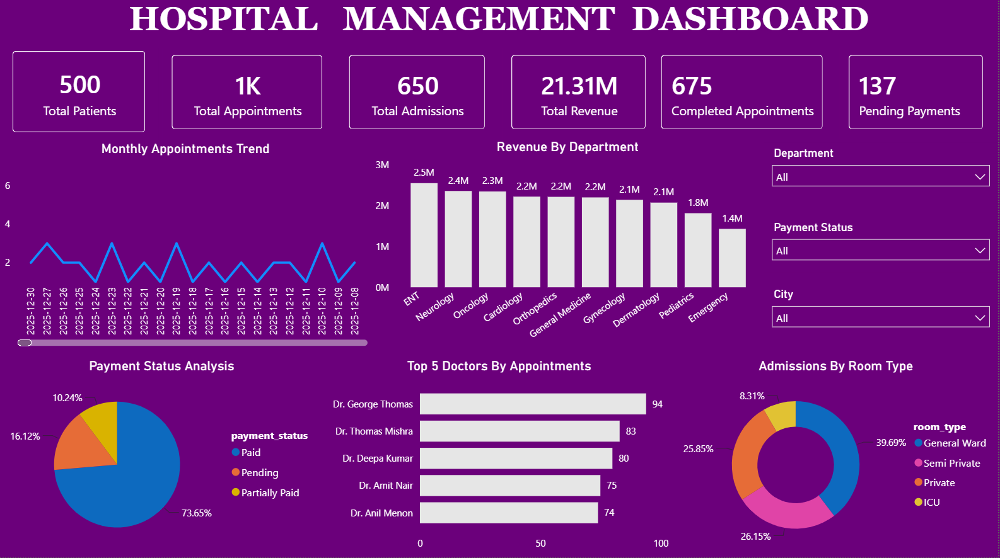

# Hospital-Management-Analysis
Hospital Management Data Analysis using SQL and Power BI. This project analyzes patient records, appointments, admissions, doctor performance, revenue, and payment status. It includes data cleaning, SQL queries, DAX measures, interactive dashboards, and KPI visualizations to gain insights into hospital operations.

## Dashboard

